# Munim

An operating system for small restaurant groups, cloud kitchens and shops (two to five outlets). India first; Australia is a
second country pack that the same code runs.

- **Munim Core** is the deterministic system of record: ordering at the till and on a web storefront, the kitchen board,
  stock, purchasing, ledgers, rosters, compliance, customers and approvals, behind a public `/v1` API.
- **Munim Intelligence** is a Manager and eight specialists on Google ADK and Gemini. They explain what happened with
  citations to ledger rows, find money leaks, and draft actions. **A person approves every change.**

The demo business is **Cobnut Bakehouse**, a synthetic two-outlet bakery in Lucknow.

**Live on Google Cloud Run (asia-south1):**
- Munim: https://food-ops-311051785081.asia-south1.run.app (press "Try the live demo")
- The Cobnut Bakehouse demo: https://cobnut-bakehouse-311051785081.asia-south1.run.app
- The video (3:57): https://www.youtube.com/watch?v=Yv8VZxpBfE4

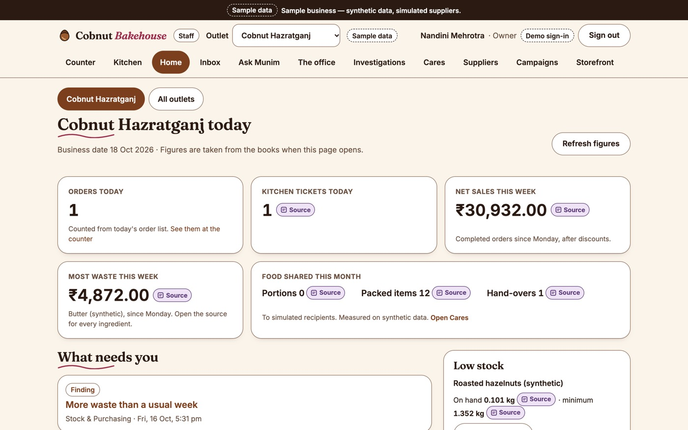

## Read this first

- **All data is synthetic.** Cobnut Bakehouse, its customers, staff and history are generated by `tools/worldgen`.
- **Suppliers are simulated.** The three supplier agents in `services/suppliers-sim` are programs, and every screen that
  shows them says "Simulated supplier". No real supplier is contacted.
- **Payments are recorded, never processed.** No money moves, and no code in this repository talks to a payment provider.
- **Nothing is sent.** No message reaches a real customer, supplier or regulator. The only outbound messages are the
  agent-to-agent messages to the simulated suppliers.
- **Any "savings" figure is measured on synthetic data.**

The rule is **simulated means labelled**: [`docs/simulation-policy.md`](./docs/simulation-policy.md).

## The guarantee

> Nothing changes the books without a named person's approval, and every number shown traces to a ledger row.

- The AI never writes to the database. intel has no database client, the database role that serves it has no write grant on
  any of the 105 book tables, and a trigger on every book table refuses any write that is not a person's own command, an
  approved decision or an allow-listed derivation.
- Every number in an AI answer is a reference to a SQL snapshot cell that core-api minted. Model prose may not contain a
  digit, a number word or a percent sign outside a reference. An answer that cannot be traced is shown as "Cannot verify".
- Nothing auto-applies. Every proposal is a draft that a named person approves, edits or rejects.

[`ARCHITECTURE.md`](./ARCHITECTURE.md) shows how the code holds each clause.

## How a change happens

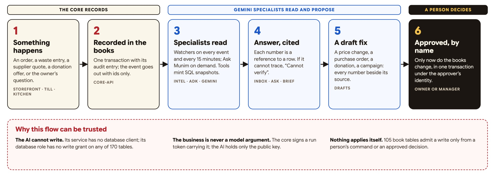

Something happens at the till, in the kitchen or in the owner's question. core-api records it with its audit entry. The
specialists read the books through SQL snapshots and answer with a citation on every number, or say "Cannot verify". A fix
is a draft, and only a named person's approval changes the books.

## A six-minute tour

The live demo is at https://cobnut-bakehouse-311051785081.asia-south1.run.app, and the same pages exist in a local run (see
below). Every staff screen says "Sample data".

1. **The shop (1 minute).** Open `/`. Pick **Cobnut Hazratganj** (`/o/<outlet>`; the counter and kitchen people work there),
   add a Hazelnut Croissant, check out as a guest and pay at the counter. The tracker at `/o/<outlet>/order/<order>` updates
   live. The server prices the cart; a total sent by the browser is ignored.
2. **The counter and the kitchen (1 minute).** Go to `/staff/sign-in`, pick **Imran Siddiqui** (counter) and open
   `/staff/counter`: your order is there. Sign out, pick **Kavya Tandon** (kitchen) and open `/staff/kitchen`, then advance
   the ticket and watch the customer's tracker change.
3. **The owner's home (1 minute).** Sign in as **Nandini Mehrotra** (owner) and open `/staff/home`. Each figure has a source
   chip; tapping it opens the snapshot rows it was rendered from. The manager, **Farah Qureshi**, sees only Cobnut Gomti Nagar.
4. **The inbox (1 minute).** `/staff/inbox` holds findings and drafts. The seed plants a butter-waste spike at Hazratganj,
   six regulars who stopped coming, sourdough about to expire, and low hazelnut stock; findings appear once the watchers have
   run, on events and every 15 minutes, with intel running. Open a draft: each number sits beside the source it was drawn
   from. Edit one and it is labelled as yours. Approve it and the change is made under your name, with an audit entry, in
   one transaction.
5. **Ask Munim (30 seconds).** `/staff/ask`. Ask a question such as "Which ingredients are below their reorder level?" and
   tap a source chip. Start a question with `@Finance` (or any specialist) to address one directly. A question the models
   cannot support is answered "Cannot verify", not guessed. With live models any question can be asked; in a run on recorded
   models only questions that have a committed fixture are answered. `/staff/office` shows the desks and replays a run's
   trace.
6. **The supplier negotiation (1 minute).** `/staff/suppliers` shows three **Simulated suppliers**. Request quotes for
   hazelnuts. The agents answer over A2A, counter within the owner's target and walk-away, and a deterministic deal review
   ends in a purchase-order draft in the inbox, its quantity and price each with a source chip that opens the negotiation's
   quote comparison.
7. **Munim Cares (30 seconds).** `/cares` is the public page of surplus food offered to simulated recipients; `/staff/cares`
   is the business's side. Impact figures say "Measured on synthetic data".

Also worth a look: `/staff/investigations` (a margin-fall investigation in Step, Plan or Auto mode), `/staff/campaigns` and
`/staff/storefront` (the storefront page builder).

## Screens

From the live demo. Every staff screen says "Sample data", and every supplier is labelled simulated.

<table>
<tr><td width="50%" valign="top">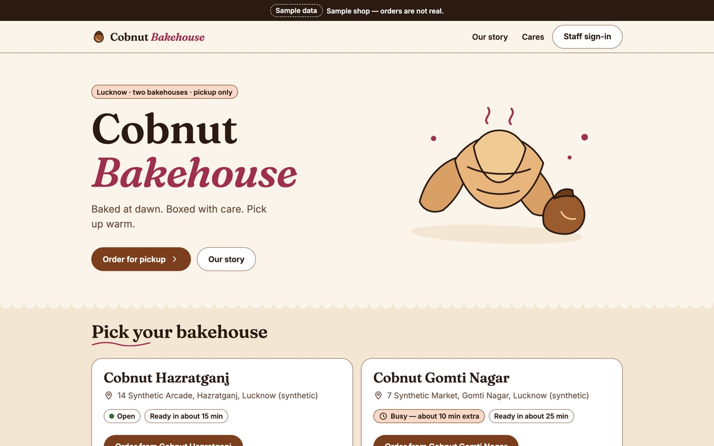<br><sub>The storefront: pick an outlet</sub></td><td width="50%" valign="top">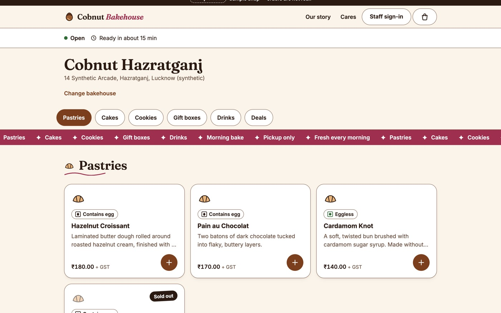<br><sub>An outlet's menu; the server prices the cart</sub></td></tr>
<tr><td width="50%" valign="top">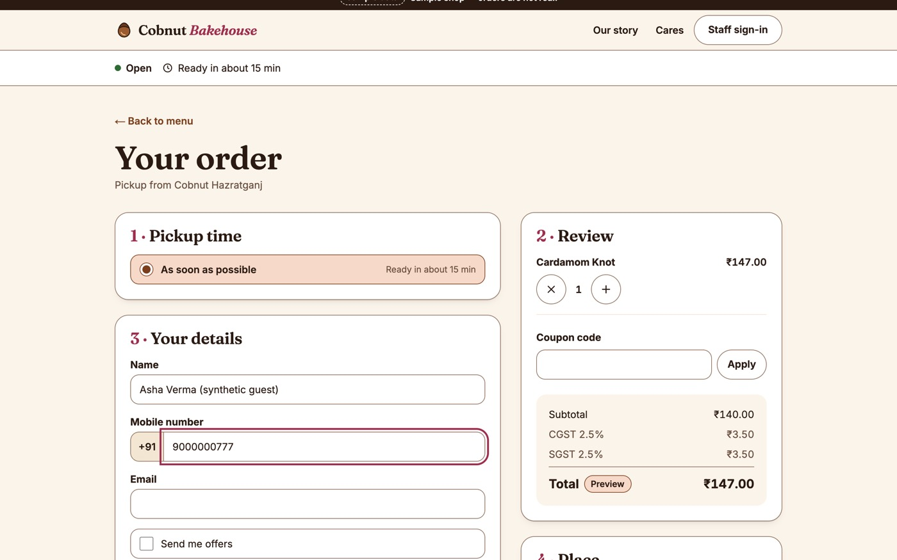<br><sub>Guest checkout; payment is recorded, never processed</sub></td><td width="50%" valign="top">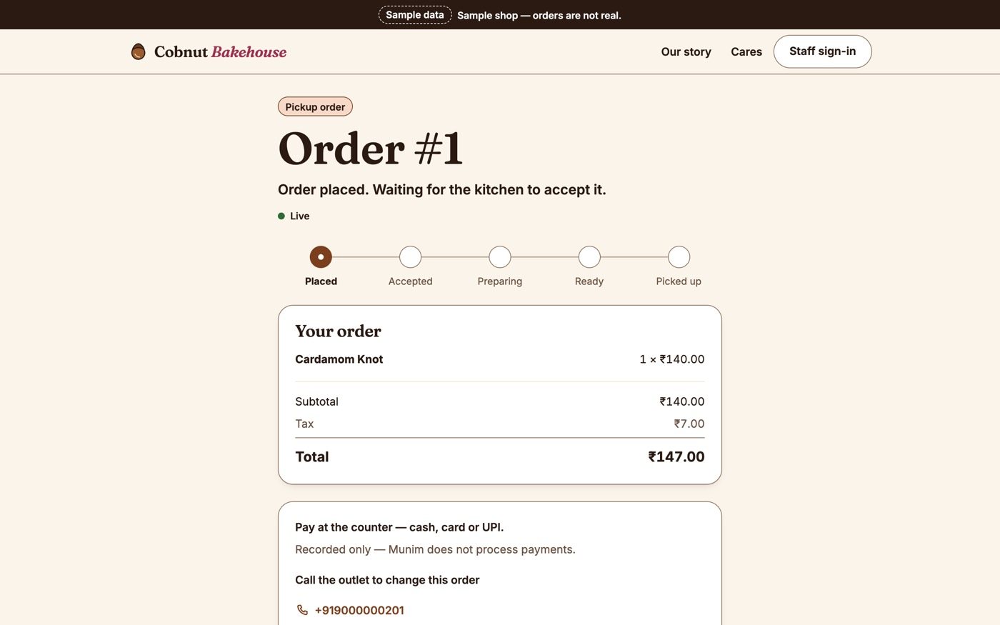<br><sub>The order tracker, updated live</sub></td></tr>
<tr><td width="50%" valign="top">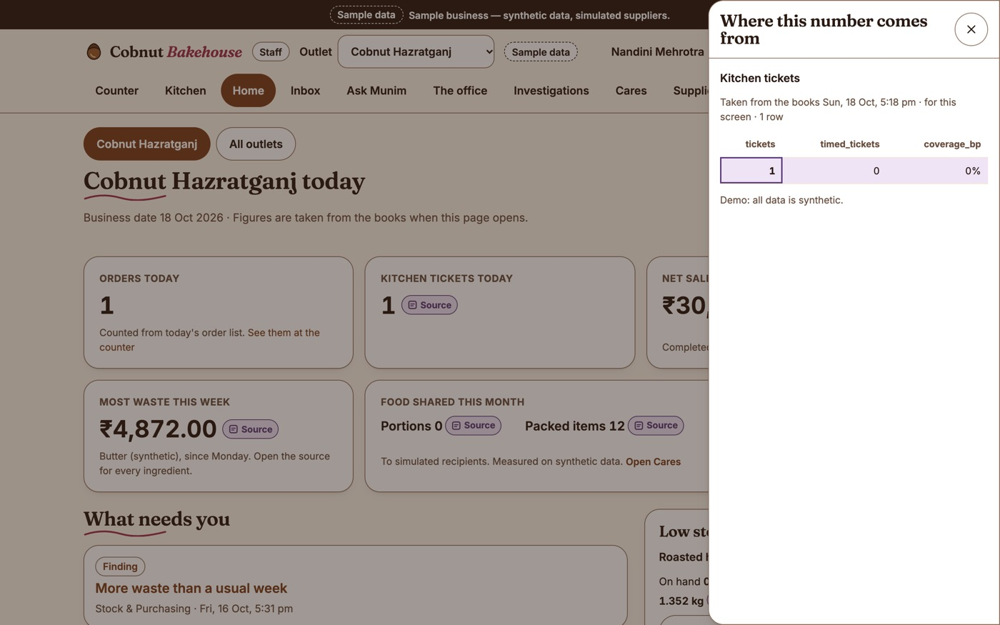<br><sub>A source chip opens the snapshot rows behind a figure</sub></td><td width="50%" valign="top">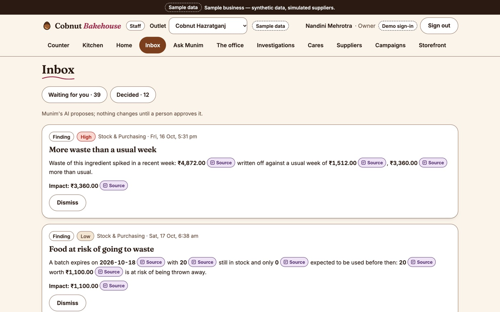<br><sub>The inbox: findings and drafts from the specialists</sub></td></tr>
<tr><td width="50%" valign="top">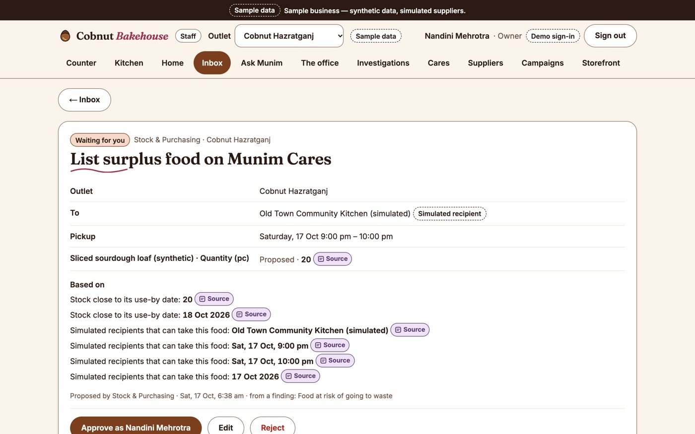<br><sub>A draft: every number beside its source, approved by name</sub></td><td width="50%" valign="top">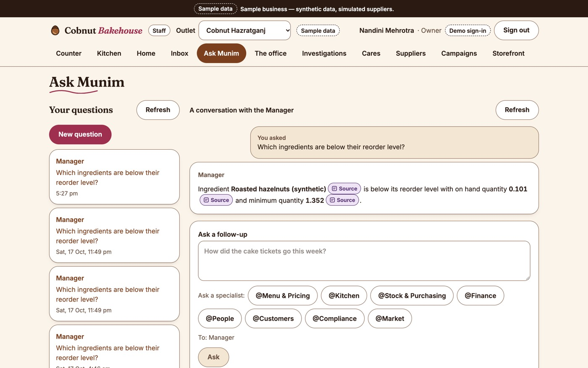<br><sub>Ask Munim: an answer with a source on every number</sub></td></tr>
<tr><td width="50%" valign="top">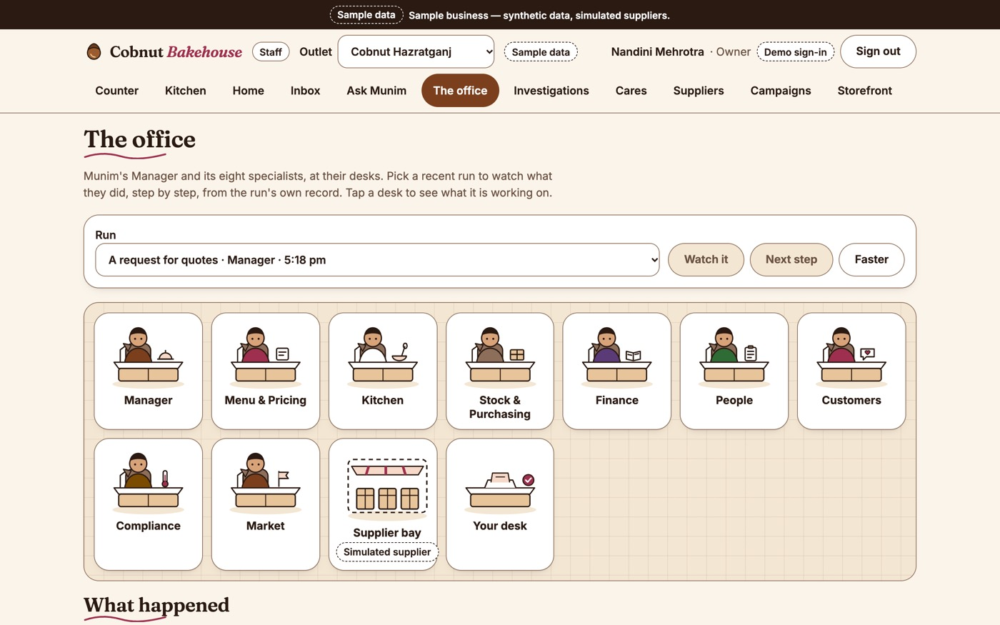<br><sub>The office: the Manager and the eight specialists at their desks</sub></td><td width="50%" valign="top">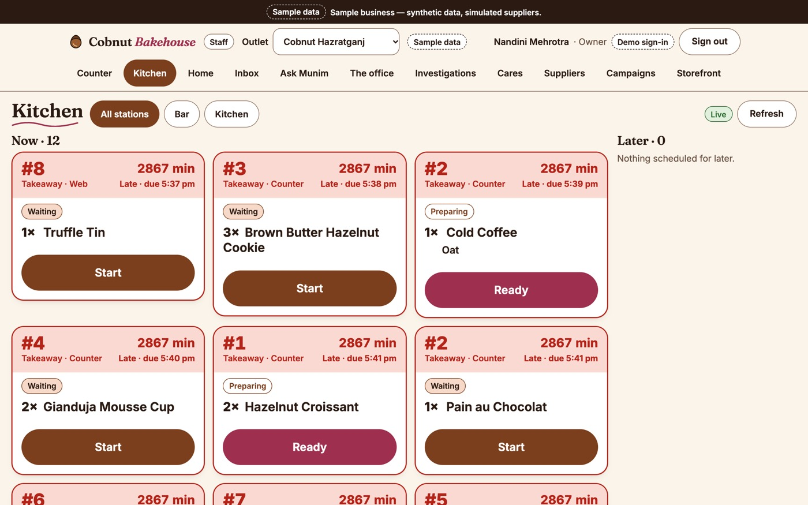<br><sub>The kitchen board</sub></td></tr>
<tr><td width="50%" valign="top">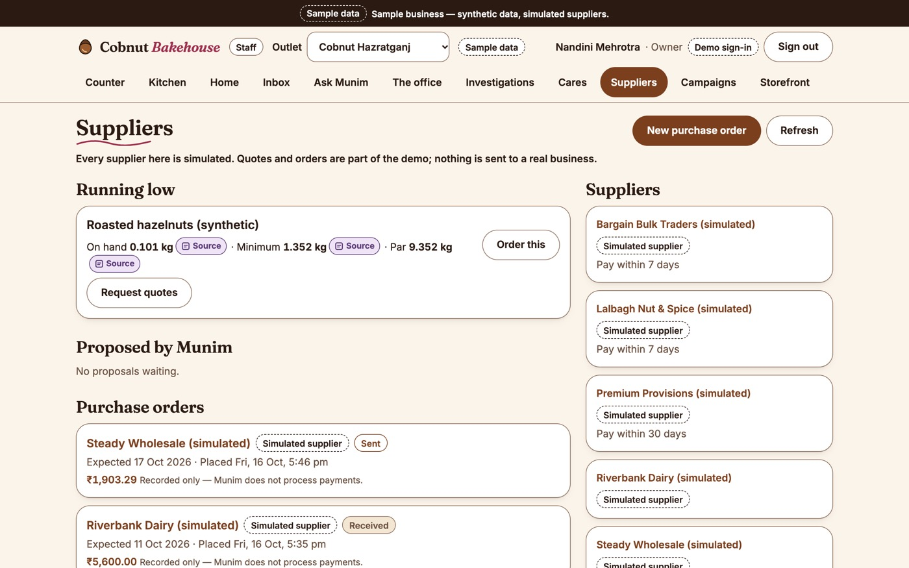<br><sub>Suppliers, every one labelled simulated</sub></td><td width="50%" valign="top">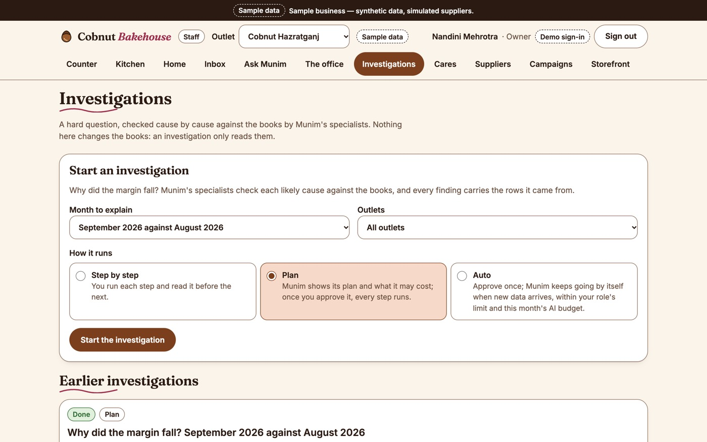<br><sub>Investigations in Step, Plan or Auto mode</sub></td></tr>
<tr><td width="50%" valign="top">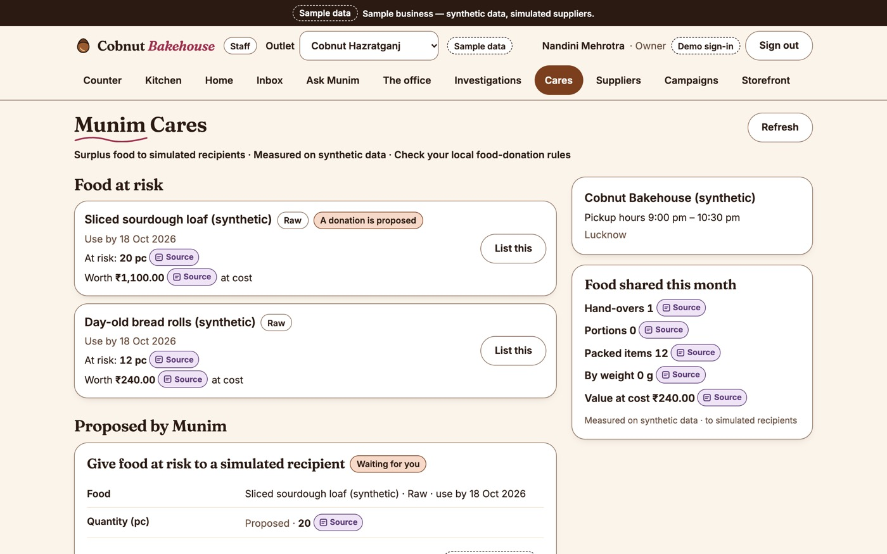<br><sub>Munim Cares: surplus food for simulated recipients</sub></td><td width="50%" valign="top">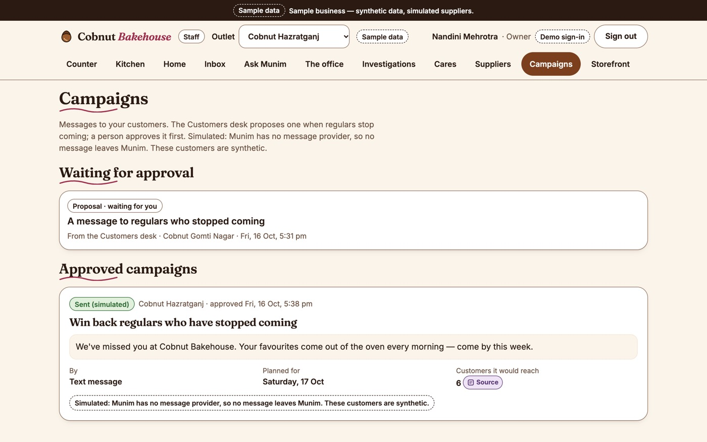<br><sub>Campaigns wait for approval</sub></td></tr>
<tr><td width="50%" valign="top">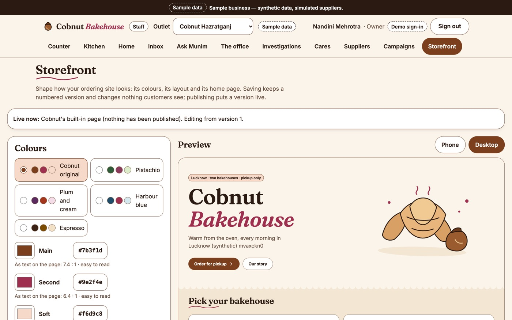<br><sub>The storefront page builder</sub></td></tr>
</table>

## How it is built

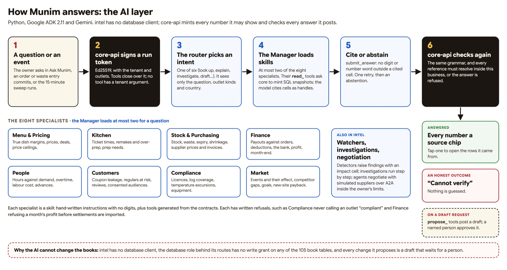

The AI layer, in [`docs/ai-agents.md`](./docs/ai-agents.md): a router, a Manager and eight specialists on Google ADK and
Gemini. Every number in an answer is a cell of a snapshot core minted; an answer that cannot cite says "Cannot verify".

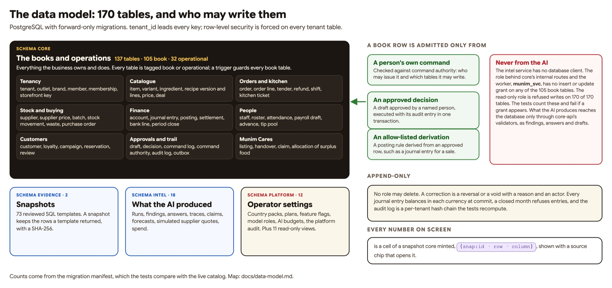

The data model, in [`docs/data-model.md`](./docs/data-model.md): 170 tables with forced row-level security, append-only
books, and a guard on every book table.

## Run it

Node 22.18 or later (it runs TypeScript directly), pnpm 11, and for the Python services Python 3.12 with uv. No Docker, no
cloud account and no API key are needed for the first two.

**The web app on its in-app mock** (the shop and the staff screens, with canned synthetic data):

```bash
pnpm install --frozen-lockfile
cp apps/web/.env.example apps/web/.env.local
(cd apps/web && node_modules/.bin/next dev -p 4320)      # http://localhost:4320
```

**The tests** (database tests start an embedded Postgres; the models are replaced by recorded responses):

```bash
pnpm -r run typecheck
pnpm -r run test
uv run --locked --directory services/intel --with pytest==9.1.1 pytest -q
uv run --locked --directory services/suppliers-sim --with pytest==9.1.1 pytest -q
```

`.github/workflows/ci.yml` runs these steps, plus the TypeScript import-boundary check and the web build, on every push.

**The real services** on your own Postgres: the database part of the deploy runbook applies unchanged
(`node db/migrate.ts`, `node db/scripts/bootstrap-roles.ts`, `node db/seeds/packs.ts`, each reading
`MUNIM_DB_URL_SESSION` from the environment), and the entry points are `services/core-api/src/server.ts`,
`services/core-worker/src/main.ts`, `python -m munim_intel` and `python -m suppliers_sim`. core-api refuses to start
without `MUNIM_IDP`: `identity-platform` (with `MUNIM_IDP_PROJECT_ID`), or `local` for development only (it also needs
`MUNIM_ENV=dev`), whose sign-in tokens are signed with a key under `.run/` (`services/core-api/src/auth/local-idp.ts`); no
command here mints them for you. The other environment names are in the table in
[`infra/gcp/README.md`](./infra/gcp/README.md). [`docs/testing.md`](./docs/testing.md) says what the tests prove.

## Deploy on Google Cloud

Cloud Run in `asia-south1` for five services, Cloud SQL for PostgreSQL, Cloud Storage, Identity Platform, Secret Manager,
Cloud Build and Artifact Registry. The one-time setup, the deploy order, rollback and cost notes are in
[`infra/gcp/README.md`](./infra/gcp/README.md); the deploy itself is `scripts/deploy-gcp.sh --project <id>`.
[`DEPLOY.md`](./DEPLOY.md) is the same path as a numbered checklist, from a fresh project to the smoke checks.


## What is here

| Path | What |
|---|---|
| `apps/web` | Next.js storefront and staff screens |
| `services/core-api` | Hono API, the only writer of Postgres |
| `services/core-worker` | The long-running worker: outbox sweep, imports, watch sweep, daily brief |
| `services/intel` | Python, Google ADK 2.11, Gemini: the Manager and specialists |
| `services/suppliers-sim` | Simulated supplier agents over A2A |
| `packages/` | Contracts (zod), domain logic, config, the TypeScript SDK |
| `db/` | Forward-only SQL migrations with row-level security, the migration runner, role bootstrap |
| `adapters/gcp` | Identity Platform and Cloud Storage adapters |
| `infra/gcp`, `scripts/deploy-gcp.sh` | Dockerfiles, Cloud Build, Cloud Run deployment and the runbook |
| `tools/worldgen` | The synthetic Cobnut Bakehouse world, seeded through the public API |

## Documentation

| Page | What it covers |
|---|---|
| [`ARCHITECTURE.md`](./ARCHITECTURE.md) | Services, data flow, the book guard, run tokens, the AI layer, live and recorded models, realtime, tenancy, country packs, Google Cloud |
| [`docs/data-model.md`](./docs/data-model.md) | Schemas, key tables, roles, append-only books, the journal, database error codes |
| [`docs/api.md`](./docs/api.md) | Authentication, commands and idempotency, route groups, errors and reason codes, server-sent events |
| [`docs/ai-agents.md`](./docs/ai-agents.md) | The Manager, each specialist, tools, investigations, the negotiation, traces, models |
| [`docs/security.md`](./docs/security.md) | Threat model, grants, tokens, secrets, edge protections, demo protections |
| [`docs/testing.md`](./docs/testing.md) | How to run the tests, what each group proves, red-proofs, recorded models |
| [`docs/decisions.md`](./docs/decisions.md) | The key design choices and why |
| [`docs/simulation-policy.md`](./docs/simulation-policy.md) | What is synthetic, simulated or recorded, and how it is labelled |
| [`docs/glossary.md`](./docs/glossary.md) | Terms |

Each service and package has a short README of its own.

## Licence

All rights reserved. No licence is granted to use, copy, modify or distribute this code.
